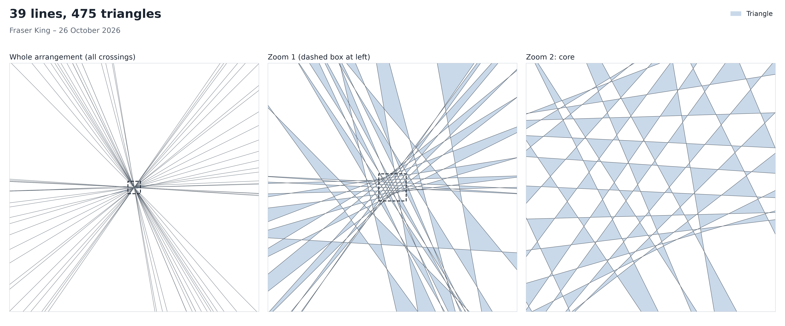
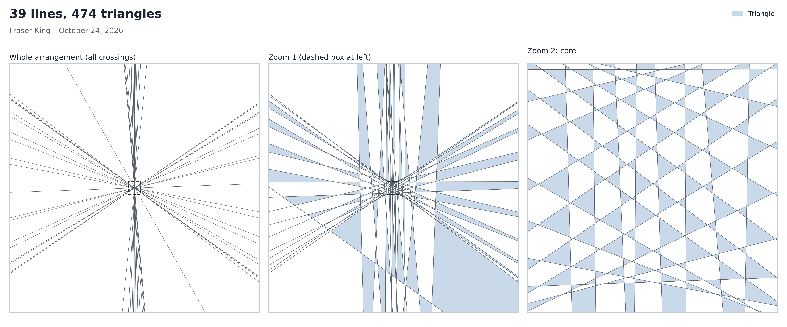
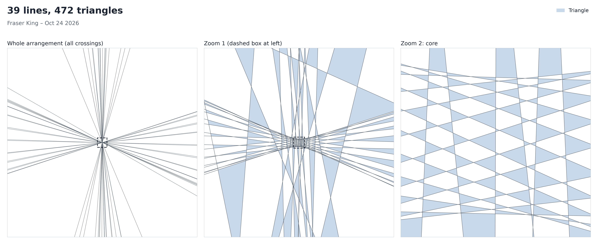
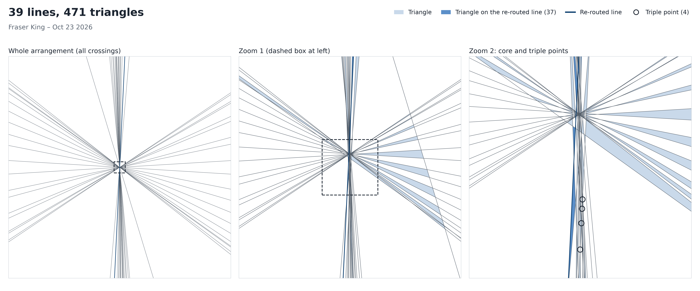
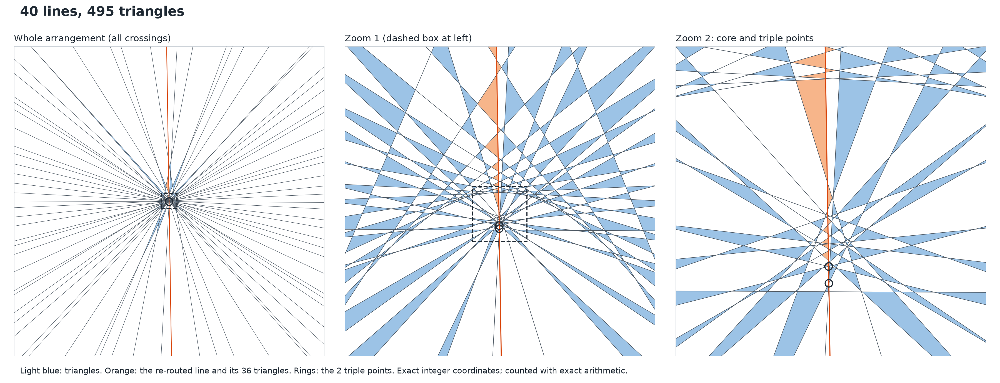
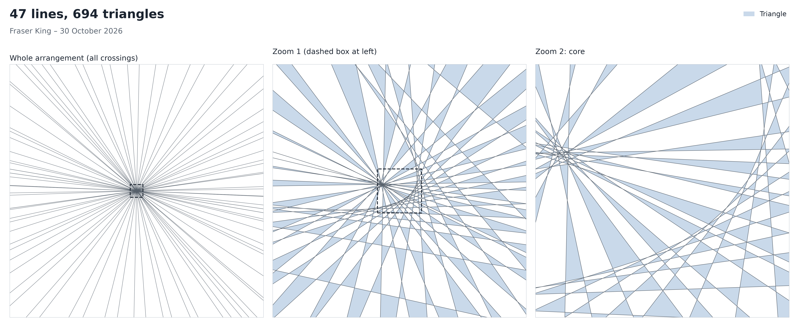
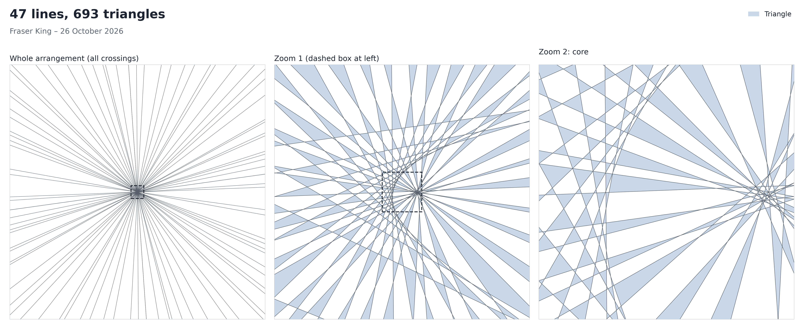
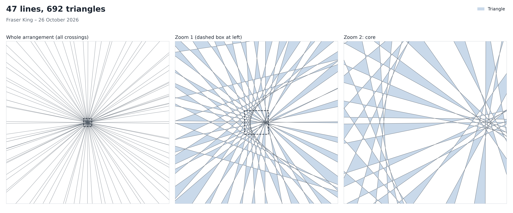
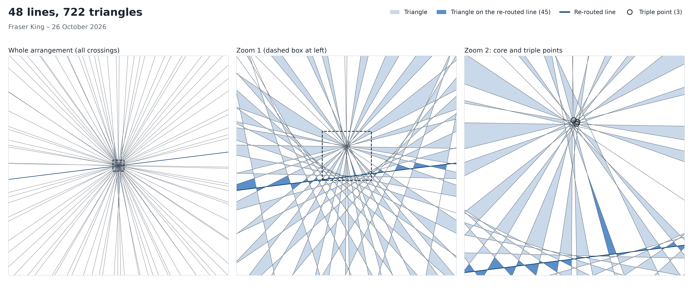

# Kobon triangles

Results from an ongoing computer search on the Kobon triangle problem: how many
non-overlapping triangles can you make with n straight lines?

Known values and bounds are collected in [OEIS A006066](https://oeis.org/A006066).
The best public collection of arrangements is the gallery by Parpalak and Utkin
([ud1/kobon-solutions](https://github.com/ud1/kobon-solutions)).

## Results

| n  | triangles | upper bound | file |
|----|-----------|-------------|------|
| 39 | 475       | 481         | [certificates/n39_475.json](certificates/n39_475.json) |
| 39 | 474 (superseded) | 481      | [certificates/n39_474.json](certificates/n39_474.json) |
| 39 | 472 (superseded) | 481      | [certificates/n39_472.json](certificates/n39_472.json) |
| 39 | 471 (ties lavaskiller, Oct 2) | 481 | [certificates/n39_471.json](certificates/n39_471.json) |
| 40 | 495       | 502         | [certificates/n40_495.json](certificates/n40_495.json) |
| 47 | 694       | 705         | [certificates/n47_694.json](certificates/n47_694.json) |
| 47 | 693 (superseded) | 705      | [certificates/n47_693.json](certificates/n47_693.json) |
| 47 | 692 (superseded) | 705      | [certificates/n47_692.json](certificates/n47_692.json) |
| 48 | 722       | 736         | [certificates/n48_722.json](certificates/n48_722.json) |
| 74 | 1763 (now beaten: 1764 by Parpalak–Utkin) | 1767 | [certificates/n74_1763.json](certificates/n74_1763.json) |
| 98 | 3119      | 3125        | [certificates/n98_3119.json](certificates/n98_3119.json) |

**39 lines, 475 triangles.** The previous best we know of is our 474 (below), and OEIS has
no value for n = 39 yet. The upper bound is floor(n(n-2)/3) = 481. The arrangement is
simple: no parallel lines and no triple points.

How it was found: from a 474-triangle arrangement found by the annealing program described
below, we deleted two lines at once and worked out exactly the best way to put two lines
back as pseudolines: 475. The resulting arrangement of pseudolines was then drawn with
straight lines from scratch, by solving for line positions that put every crossing on the
correct side of every line. The 474 came from the 470-triangle arrangement
multiline_plateau_n39_470_9fe1da3675e9e6a5 in the
[rsi-kobon-triangles](https://github.com/Rohith18p/rsi-kobon-triangles) repo.

**39 lines, 474 triangles** (superseded by the 475 above). The arrangement is simple: no
parallel lines and no triple points.

How it was found: we extended lavaskiller's annealing program so that a line can be pinned
exactly through a crossing point of two other lines, which creates a triple point. While it
runs, the program can pin and release lines, so it can pass through arrangements with triple
points, which the original program cannot represent. Started from a 470-triangle arrangement
with triple points in the [rsi-kobon-triangles](https://github.com/Rohith18p/rsi-kobon-triangles)
repo (multiline_plateau_n39_470_068ffb94d6bbe4d3), one 15-minute run reached 474 and ended
with no triple points left. The lines were then rounded to integers and the triangles counted
exactly. The same program also found two different 473-triangle arrangements in its first hour.

**39 lines, 472 triangles** (superseded by the 474 above).

How it was found: we ran lavaskiller's simulated annealing program (from
[lavaskiller/openmath-2026-htpeo](https://github.com/lavaskiller/openmath-2026-htpeo/tree/main/entries/hills/kobon-n39-lavaskiller))
for much longer and from many more starting arrangements than the original run. It moves
one line at a time by a small random amount and keeps the change when the number of
triangles does not drop too much. One 15-minute run, started from a 470-triangle
arrangement in the [rsi-kobon-triangles](https://github.com/Rohith18p/rsi-kobon-triangles)
repo, reached 472. The lines were then rounded to integers and the triangles counted exactly.

**39 lines, 471 triangles.** *Correction, 24 October 2026:* we missed that a different
471-triangle arrangement was published first, by lavaskiller (team HTPeo) on 2 October
2026, with a Lean certificate
([lavaskiller/openmath-2026-htpeo](https://github.com/lavaskiller/openmath-2026-htpeo/tree/main/entries/hills/kobon-n39-lavaskiller)).
So 471 is not a new value for n = 39. Our arrangement was found independently and is not
the same one: it has four triple points, while theirs has none.

We started from a 470-triangle arrangement, deleted one line, and computed
exactly which way of putting one line back gives the most triangles. For this one the best
re-inserted line passes through no crossing points and gives 471. To draw it straight, the
other lines had to move slightly, while keeping the existing four triple points exact and
keeping the new line's direction in the right range.

**40 lines, 495 triangles.** The previous best we know of is 494, and OEIS has no
value for n = 40 yet. The arrangement has two triple points, both on the same line,
and no parallel lines.

How it was found: take a 494-triangle arrangement from our search, delete one line,
and work out exactly which way of putting a line back (as a pseudoline, allowed to
pass through existing crossing points) gives the most triangles. For this base the
answer is 495, using a line through two crossing points. The rest of the
arrangement was then nudged slightly until the straight line through those two
points crosses everything in the same order. This is the same kind of move as in
Parpalak and Utkin's 50-line arrangement with 792 triangles.

**47 lines, 694 triangles.** The previous best we know of is our 693 (below), and OEIS has
no value for n = 47 yet. The upper bound is Tamura's floor(n(n-2)/3) = 705. The arrangement
is simple: no parallel lines and no triple points.

How it was found: one more round of the same two-line move, starting from a 693-triangle
arrangement found the same way. We deleted two lines at once, worked out exactly the best way to put two pseudolines back
(694), straightened the whole arrangement from scratch and counted the triangles exactly.

**47 lines, 693 triangles** (superseded by the 694 above). The previous best we knew of was
691 (Zarzuelo's general construction). The arrangement is simple: no parallel lines and no
triple points.

How it was found: the same two-line move as for the 692 below, applied twice. We started
from a 691-triangle arrangement of the standard kind (46 lines plus one added line),
annealed it, re-routed two lines to get 692, then re-routed two more to get 693. Each time
the whole arrangement was straightened and the triangles counted exactly.

**47 lines, 692 triangles** (superseded by the 693 above). The arrangement is simple: no
parallel lines and no triple points.

How it was found: start from the 49-line arrangement 49-b5 in Parpalak's
[triangle-maximal-18-series](https://github.com/parpalak/triangle-maximal-18-series)
gallery and delete two lines, which leaves 676 triangles. The annealing program used for
39 and 48 lines brought it to 691. Then we deleted two lines at once and worked out exactly
the best way to put two lines back as pseudolines: 692. The resulting arrangement of
pseudolines was then drawn with straight lines from scratch, by solving for line
positions that put every crossing on the correct side of every line. Re-routing one line
at a time never got past 691.

**48 lines, 722 triangles.** The previous best we know of is 721 (the
[rsi-kobon-triangles](https://github.com/Rohith18p/rsi-kobon-triangles) table, and
Zarzuelo's general construction), and OEIS has no value for n = 48 yet. The upper bound
in the table is Tamura's floor(n(n-2)/3) = 736. The arrangement has three triple points
and no parallel lines.

How it was found: start from the 49-line arrangement 49-b5 in Parpalak's
[triangle-maximal-18-series](https://github.com/parpalak/triangle-maximal-18-series)
gallery and delete one line, which leaves 720 triangles. A 30-minute run of the annealing
program that can pin lines through crossing points (the one used for 39 lines) brought
it to 721 with one triple point. Then, as for 40 lines, we deleted one line and worked
out exactly which way of putting a line back gives the most triangles: 722. The rest of
the arrangement was nudged slightly so that this line could be drawn straight.

**74 lines, 1763 triangles.** We start from a perfect 73-line arrangement (1727
triangles) and add one line far out, beyond every crossing point, at an angle where it
closes off 36 of the outer wedges into new triangles. None of the original triangles
are lost.

The idea itself is not new. Bartholdi, Blanc and Loisel describe it, and Zarzuelo
proves that it always gains m triangles for 2m+1 lines in this situation. What's new
here is the explicit 74-line file. The classical construction gives 1752 for n = 74.
The 73-line base is a cleaned-up version of a perfect arrangement from the
[rsi-kobon-triangles](https://github.com/Rohith18p/rsi-kobon-triangles) repo.

*Update, 23 October 2026:* Parpalak and Utkin have since added a 74-line arrangement
with 1764 triangles to their gallery
([ud1/kobon-solutions](https://github.com/ud1/kobon-solutions)), so 1763 is no longer
the best known for n = 74.

**98 lines, 3119 triangles.** Same construction: a perfect 97-line arrangement (3071
triangles, a doubling from the rsi-kobon-triangles repo) plus a far line that adds 48.
The classical construction gives 3104 for n = 98, and we don't know of an explicit
98-line arrangement with more.

There are interactive pictures in [viewer/n40_495.html](viewer/n40_495.html) and
[viewer/n74_1763.html](viewer/n74_1763.html).
Download it and open it in a browser. Most of the triangles are tiny, so zoom in.

## Adding one line to a perfect arrangement

We also proved a small lemma (see [notes/single_line.md](notes/single_line.md)).
Take a perfect arrangement of n = 2m+1 lines and add one more line that doesn't pass
through any existing crossing point. The number of triangles goes up by at most m.
The only exception is a gain of m+1, which needs the new line to cross one of the
segments that isn't part of any triangle. There are 2 of these when n ≡ 1 (mod 3) and
none otherwise.

So for these arrangements, the far-out line is already the best single line you can
add. Using this as a search constraint, we checked:

* None of the 88 perfect 43-line arrangements in the Parpalak–Utkin gallery reaches
  609 triangles with one more line in general position. 608 is the current best for
  n = 44.
* No line in general position added to our perfect 73-line base reaches 1764.

Lines through existing crossing points aren't covered by the proof, but they are now
checked by computer: for each of the 88 bases we compute the best possible added
line exactly, including pseudolines and lines through crossing points. None of them
gets past 608.

## Checking a file

Every file lists its lines as integer triples (a, b, c), meaning a·x + b·y + c = 0.
The counter only needs Python:

    python3 verify.py certificates/n74_1763.json

It uses exact integer arithmetic, so there is no floating point anywhere.

For 39, 40, 47 and 48 lines there is also a list of the triangles themselves:
[certificates/n39_475_triangles.json](certificates/n39_475_triangles.json),
[certificates/n47_694_triangles.json](certificates/n47_694_triangles.json),
[certificates/n47_693_triangles.json](certificates/n47_693_triangles.json),
[certificates/n39_474_triangles.json](certificates/n39_474_triangles.json),
[certificates/n39_472_triangles.json](certificates/n39_472_triangles.json),
[certificates/n39_471_triangles.json](certificates/n39_471_triangles.json),
[certificates/n40_495_triangles.json](certificates/n40_495_triangles.json),
[certificates/n47_692_triangles.json](certificates/n47_692_triangles.json) and
[certificates/n48_722_triangles.json](certificates/n48_722_triangles.json). Each entry
gives the three lines (0-based indices into the lines file) and the corners as exact
fractions. A second script checks the list without counting anything itself:

    python3 check_triangles.py certificates/n40_495.json certificates/n40_495_triangles.json

For each listed triangle it checks that the three lines really bound a triangle (no two
parallel, not all through one point) and that no other line passes through its inside.
Such a triangle is a face of the arrangement, and different faces never overlap, so
495 passing triangles show directly that 40 lines can make at least 495.

## Status

Still searching, mainly for n = 39, 40, 44, 47 and 48, where OEIS has no value yet.
This repo only gets updated when something is verified.

Fraser King, 2026
